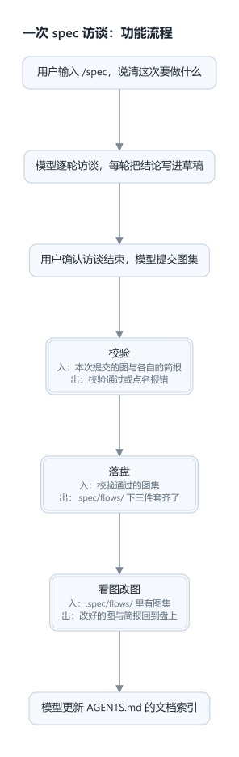

# dsh-spec-mode

DSH 插件：由模型主导的增量访谈，把用户逐步浮现的需求固化成`.spec/flows/` 下的一册流程图集——每张图一份模型、一张图、一份需求简报；再加一页会话视图，能看图、能改图。



这四张是插件自己画的，就是这个仓库的 `.spec/flows/`：总览、校验、落盘、看图改图，`npm run flow` 重新生成。

## 文档

按顺序读，每份只建立在它前面几份之上。

- [000 原则](docs/000-philosophy.md)
- [001 领域模型](docs/001-domain.md)
- [002 规则与权限](docs/002-rules.md)
- [003 生命周期](docs/003-lifecycle.md)
- [004 配置与提示词](docs/004-config.md)
- [005 界面](docs/005-panel.md)
- [006 部署](docs/006-deployment.md)
- [007 架构](docs/007-architecture.md)
- [008 手册](docs/008-cookbook.md)

## 装

```sh
dsh plugin --profile web add link:~/Projects/dsh-spec-mode
```

装完重启 `dsh web`。加载器里的行为名是 `include:spec-mode`。

Desktop 的 `desktop` profile 由应用独占，命令行不能写它（`dsh plugin --profile desktop` 直接报错）。在应用里装：打开「插件」页 → 添加插件 → 包名或地址一栏填仓库的**绝对**路径，例如 `/home/me/Projects/dsh-spec-mode`；相对路径会被拒。

| 项 | 内容 |
| --- | --- |
| 包目录 | 仓库根目录，入口是根目录的 `index.js`，前端半在 `client.js` |
| 依赖 | 只用 Node 自带的加密、文件、路径、子进程四类模块；不装宿主运行时包，也不装图像库 |
| 必需注入 | 工具、系统提示词段落、会话投影；命令、提问通道、web 路由可选，缺了照样激活，只是少了对应的进出方式 |
| 前端平台 | `dsh.client.platform` 恒为 `web`：Desktop 载入的是同一份前端，换值会让加载器认不出这个视图 |

## 用法

```sh
/spec                 # 只切模式，不提交任何消息
/spec 做一个导出功能   # 进入模式，并把这句话作为这一轮的用户消息
/spec off             # 手动退出，工作树恢复可写，草稿保留
```

裸 `/spec` 不合成消息：访谈从用户真正写下的东西开始——命令后面的想法，或他随后发的第一条普通消息。

| 当前状态 | 输入 | 行为 | 回执 |
| --- | --- | --- | --- |
| 未启用 | `/spec` | 只进入模式，不提交消息 | `Spec mode on. 工作树只读；直接发消息即可开始访谈。草稿：<路径>` |
| 未启用 | `/spec <想法>` | 进入模式，想法成为这一轮的用户消息 | `Spec mode on. 草稿：<路径>` |
| 已启用 | `/spec <想法>` | 只提交这一轮的用户消息 | 同上 |
| 已启用 | `/spec` | 只回执，不提交消息 | `Spec mode on. 工作树只读；直接发消息即可开始访谈。草稿：<路径>` |
| 已启用 | `/spec off` | 退出，草稿保留，注入一行落盘指引 | `Spec mode off. 草稿保留在 <路径>` |
| 未启用 | `/spec off` | 什么都不做 | `Spec mode 未开启。` |
| 未启用 + 计划模式活跃 | `/spec` | 拒绝进入，状态不变 | `Exit plan mode first.` |

状态从会话日志折叠得出，恢复、分叉、重放都能还原这个会话的模式与草稿。

## 产物：一册图集

访谈只产出 `.spec/flows/` 下的文件，此外更新一份 `AGENTS.md`。

| 文件 | 读者 | 内容 |
| --- | --- | --- |
| `<id>.json` | 插件、模型、界面 | 这张图的模型：`id`、`kind`、`name`、`scope`、`nodes`、`edges` |
| `<id>.png` | 人 | 由模型画出的图；本机没有转换器时是 `<id>.svg` |
| `<id>.brief.md` | 后续会话的模型，当计划读 | 这张图自己的需求简报：目标 / 要做什么 / 验收 / 约束 |
| `AGENTS.md` | 宿主每个会话 | 文档索引 + 可证伪的开发规范规则 |

访谈草稿是 `.spec/draft.md`——访谈期间唯一可写的文件，落盘时删除。

### 一张图是什么

```json
{
  "id": "check",
  "kind": "module",
  "name": "校验",
  "scope": "从收到提交的图集到给出通过或逐条报错",
  "nodes": [
    { "id": "n1", "label": "逐张查 id、kind、name、scope" },
    { "id": "n2", "module": "land", "ports": ["入：校验通过", "出：写盘"] }
  ],
  "edges": [{ "from": "n1", "to": "n2" }]
}
```

`id` 是文件名；`name` 是画在框上的显示名。两者分开是因为引用靠前者、读者靠后者。

图的形状、图集的规则、简报的四节见 [001 领域模型](docs/001-domain.md)。

转换器按顺序探测，用第一个能用的：`rsvg-convert`、Chromium 系浏览器（Chrome / Chromium / Edge，headless）、`inkscape`。一个都没有时留下 `<id>.svg`——它同样是图，宿主预览照样显示。

## 会话视图：流程图页

会话视图多一页「流程图」（与「对话」「轨迹」并列）：左栏列出图集，中间是选中那张的图，右栏是它的简报与编辑表单。打开的会话决定它读哪个项目的 `.spec/flows/`。

布局、控件与保存规则见 [005 界面](docs/005-panel.md)。

## 验证清单

手工步骤，逐条对应一个可观察结果。

1. **加载**：插件管理列表里这一行是已启用、生命周期活跃。
2. **进入**：输入框打斜杠，菜单里出现 spec（无图标，属预期）。
   - 裸 `/spec` → 回执说模式已开、工作树只读、草稿在哪，**对话里不出现任何消息、模型不启动**；随后发一条消息 → 模型按协议开始访谈。
   - `/spec 做一个 X` → 回执给出草稿路径，想法成为这一轮的用户消息。
3. **草稿位置**：在没有版本库目录的目录里重复第 2 条 → 草稿落在该目录的 `.spec/` 下。
4. **守卫**：让模型写一个仓库文件 → 工具返回「工作树只读」，文件未创建。
5. **放行边界**：让模型写 `.spec/flows/overview.json` → 同样被拦；写草稿的绝对路径 → 成功。
6. **校验**：用不合格参数调 `spec_resolve`（例如把「因为……」写进 brief）→ 工具报错点名字段路径，**不弹确认框**，模式不变。
   - 图的毛病同样点名：两个框都没有入边 → 报「有 2 个起点」；模块节点没写 `ports` → 报那个字段；两张总览 → 报「只能有一张」。
7. **退出**：用合格参数调 `spec_resolve` → 弹确认框，正文能看到每张图的显示名与图上那些框。
   - 选「继续访谈」→ 工具结果写明不要重复调用；`write` 仍被拦；`.spec/flows/` 下没有新文件。
   - 选「退出并落盘」→ `.spec/flows/` 下每张图三个文件齐了，草稿消失；此后写入不再被拦；模型接着更新 `AGENTS.md`。
8. **跨会话**：保留草稿，开一个新会话 → 模型应提到那份草稿，并对照 `.spec/flows/` 与 `AGENTS.md` 判断它是否已被取代。
9. **软约束**：让模型写一份超过 200 行的 `AGENTS.md` → 工具结果里带行数警告，写入成功。
10. **持久化**：进入模式后关掉会话再恢复 → 模式仍开启。
11. **视图**：切到「流程图」页 → 左栏列出总览与模块图；点一张 → 主区出现图，右栏出现它的 brief。
12. **改图**：改一个框的文字 → Ctrl/Cmd+S → 盘上 `.json` 里那段文字变了，图重画；`git status` 里只有该图三件套变化。
13. **冲突**：先在编辑器里改同一个 `.json`，再在页面保存 → 页面报冲突，盘上内容不变。
14. **删除**：删一张被引用的图 → 被拒，并写明哪张图在引用它；删总览 → 被拒。
15. **无转换器**：临时把 `rsvg-convert` 从 PATH 移开 → 落盘后留下 `<id>.svg`，界面照常显示。

## 已知限制

| 限制 | 表现 |
| --- | --- |
| 用 shell 写文件不拦 | 重定向能绕过守卫 |
| 子代理不受限 | 状态按会话分键，子代理日志里没有进入记录 |
| 草稿删除保护休眠 | 默认工具集没有删除、移动、改名类工具 |
| 模式互斥单向 | 计划模式不知道 spec mode 存在 |
| `AGENTS.md` 内容模型驱动 | 只有行数与进度两项提醒，没有代码校验 |
| 提醒是近似判定 | 只查结构，每类最多一条，误报不阻止写入 |
| 草稿不自动清理 | 靠落盘时删除 |
| 没有配置项 | 协议文本、产物路径、行数预算都是代码常量 |
| 出图依赖本机转换器 | 没有 rsvg-convert、浏览器或 inkscape 时留下 SVG，不生成 PNG |
| 确认框正文可能截断 | 长访谈显示不全，但落盘内容来自结构化参数，不受影响 |
| 相对路径草稿按会话工作目录判 | 与沙箱工作区根不同基准时是已知边界 |
| 排版靠改模型 | 位置是推导值；要改结构就改连线，要换左右就调顺序 |
| brief 是纯文本 | 等宽文本域，按 Markdown 原文编辑 |
| 一个浏览器页签只认自己的会话 | 视图按传入的 session id 取项目；同一仓库的两个会话各看各的 |
| 图集不跟版本控制联动 | 「这次改了什么」看 `git diff`，不按 commit 回放 |

## 开发

模块分工、依赖规则、两张索引表（每个文件一行、每个测试一行）见 [007 架构](docs/007-architecture.md)。开发规范与环境坑见 [AGENTS.md](AGENTS.md)。

```sh
npm test               # 两套一起跑
node selftest.mjs      # 70 项：纯逻辑
node landing-test.mjs  # 13 项：真实 apply() 接假上下文，跑一遍退出落盘
npm run flow           # 重新生成 .spec/flows/ 下这个仓库自己的图集
```

### 坑

- **命令记录在处理器之前入日志。** 处理函数里判「本来是否开启」必须用已提交状态，用有效状态会读到本次选择本身。
- **批准退出后同轮写入靠进程内旁路。** 旁路只保证同一轮的即时判定；持久真相是工具结果的折叠。
- **投影键是全局唯一的。** 与别的插件撞键且状态版本号不同会抛错。改名要连带投影键一起改。
- **工具守卫是全局的。** 它按调用所属会话取状态；每次写入都走一次锚点查找，要改成缓存前先量。
- **提示词段落的提供者抛异常会打断整个装配。** 已包异常兜底返回空串。
- **命令的输入提示影响菜单可见性。** 本命令的提示是 `[off|初始想法]`。
- **落盘写在工具里，不在模型手里。** 产物由 `spec_resolve` 在批准后直接写；改这块时失败要抛错并保留草稿，否则会留下「模式退了、文件没写」的状态。
- **参数 schema 是标准 JSON Schema。** 必填是对象上的 `required: [...]` 数组；给属性写 `required: true` 会被提供方直接拒绝。
- **折行宽度是估算的。** 字符宽度按中日韩全角 / 拉丁半角折算，带 6% 容差；改字号或边距后要重新看几张图。
- **回边先摘出去再分层。** `backEdgesOf` 用一次深度优先找出指回栈上的边；分层、排布、跨度判断都把它排除，否则「某一层比它自己还深」。
- **跨层连线走图侧面的通道。** 跳过中间层的连线如果沿两框共有的那一列往下画，会被中间各行后画的框盖住；现在它先横出到图外，再下到目标行上方回来。通道按「它要回到哪一行」分组，回到同一行的回箭头共用一条竖线。
- **回箭头走哪一侧按两端的中点算。** 目标偏左就用左通道，反之用右；固定用右侧会让左半部分的回箭头横穿整张图。
- **间隙高度按横穿条数算。** 一个间隙里有几条横穿，就按 `RUN_BASE + RUN_STEP * 条数` 定高；写死高度会让第 4 条起的横穿叠在同一条线上，读成一根箭头。
- **画布按画出来的东西定尺寸。** 从最后一行发出的回箭头会跑到行下方，被推到框外的标签会跑到右侧，两处都把画布撑大。
- **模块框上的字只在渲染时取。** 父图模型里存一份，改名时就会留下一条没人报的旧字。
- **窄窗口要换布局。** Desktop 的窗口最小 520px，侧栏占掉 280px；三栏并排时工具条和表单会跑到右边界外，改成按页面自身宽度切上下堆叠。

### 上游风险

- **投影注册表契约**：注册时只校验状态版本号是非负整数、同键同版本；状态结构只在恢复持久化缓存行时被校验。本插件用的是鸭子类型的校验对象；上游若要求真 schema，这里要跟着换。
- **客户端命令菜单**：菜单只推命令名、描述与输入提示，图标来自客户端自己的硬编码表；上游开放图标通道后本插件不用改代码。
- **`conversation.view`**：视图以 list slot 注册，与 `chat`、`trajectory` 并列。上游若改这个 slot 的 ownerProps 或注册选项，`client.js` 的注册项与 `props.sessionId` 要跟着改。
- **宿主 HTTP 路由**：`ctx.webServer.register({ kind: 'prefix', ... })` 与 `ctx.connection.requestRejection` 是当前写法；上游若改路由契约或鉴权钩子，`flows-api.js` 要跟着改。
- **工具参数校验**：参数的 JSON Schema 直接透给提供方；提供方若开始理解更多关键字，`exitParameters` 里没用到的约束可以补上。
- **转换器**：PNG 依赖本机已有的 rsvg-convert / 浏览器 / inkscape，探测列表在 `rasterize.js`。

## 协议

[MIT](LICENSE)
