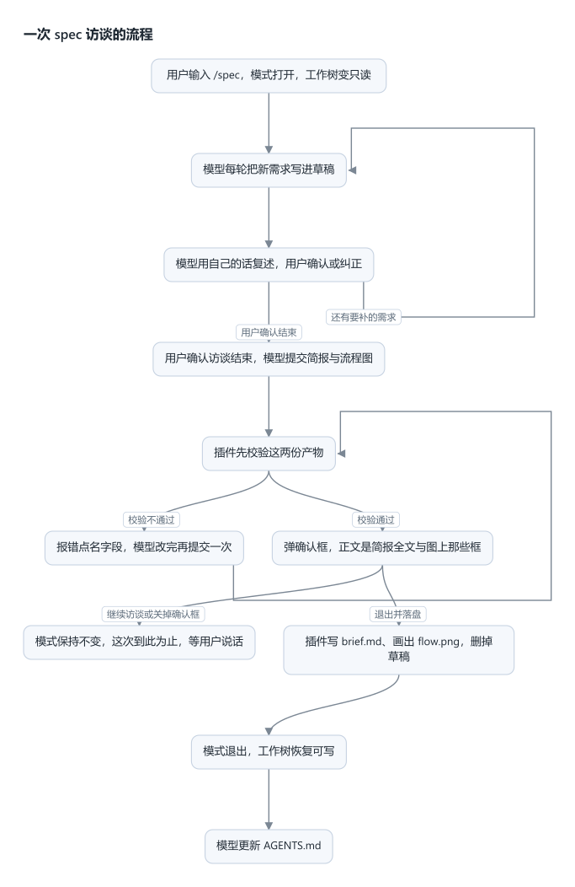

# dsh-spec-mode

DSH 插件：由模型主导的增量访谈，把用户逐步浮现的需求固化成两份产物——给 AI 读的需求简报、给人看的流程图。



这张图是本插件自己画的，就是这个仓库的 `.spec/flow.png`，`npm run flow` 重新生成。

## 装

```sh
dsh plugin --profile web add link:~/Projects/dsh-spec-mode
```

装完重启 `dsh web`。加载器里的行为名是 `include:spec-mode`。

| 项 | 内容 |
| --- | --- |
| 包目录 | 仓库根目录，入口是根目录的 `index.js` |
| 依赖 | 只用 Node 自带的加密、文件、路径、子进程四类模块；不装宿主运行时包，也不装图像库 |
| 必需注入 | 工具、系统提示词段落、会话投影；命令与提问通道可选，缺了照样激活，只是没有进出方式 |

## 用法

```sh
/spec                 # 只切模式，不提交任何消息
/spec 做一个导出功能   # 进入模式，并把这句话作为这一轮的用户消息
/spec off             # 手动退出，工作树恢复可写，草稿保留
```

裸 `/spec` 不合成消息：访谈从用户真正写下的东西开始——命令后面的想法，或他随后发的第一条普通消息。

| 当前状态 | 输入 | 行为 | 回执 |
| --- | --- | --- | --- |
| 未启用 | `/spec` | 只进入模式，不提交消息 | `Spec mode on. 工作树只读；直接发消息即可开始访谈。草稿：<路径>` |
| 未启用 | `/spec <想法>` | 进入模式，想法成为这一轮的用户消息 | `Spec mode on. 草稿：<路径>` |
| 已启用 | `/spec <想法>` | 只提交这一轮的用户消息 | 同上 |
| 已启用 | `/spec` | 只回执，不提交消息 | `Spec mode on. 工作树只读；直接发消息即可开始访谈。草稿：<路径>` |
| 已启用 | `/spec off` | 退出，草稿保留，注入一行落盘指引 | `Spec mode off. 草稿保留在 <路径>` |
| 未启用 | `/spec off` | 什么都不做 | `Spec mode 未开启。` |
| 未启用 + 计划模式活跃 | `/spec` | 拒绝进入，状态不变 | `Exit plan mode first.` |

状态从会话日志折叠得出，恢复、分叉、重放都能还原这个会话的模式与草稿。

## 两份产物

访谈只产出两份文件，都在项目锚点下的 `.spec/` 目录；此外更新一份 `AGENTS.md`。

| 产物 | 路径 | 读者 | 内容 |
| --- | --- | --- | --- |
| 需求简报 | `.spec/brief.md` | 后续会话的模型，当计划读 | 目标 / 要做什么 / 验收 / 约束 |
| 功能流程图 | `.spec/flow.png` | 人 | 从上往下读的图：框是谁做什么，箭头是之后发生什么 |
| 项目基线 | `AGENTS.md` | 宿主每个会话 | 文档索引 + 可证伪的开发规范规则 |

访谈草稿是 `.spec/draft.md`——访谈期间唯一可写的文件，落盘时删除。

### brief.md

```md
# 标题

## 目标
一句话：做完之后什么状态成立

## 要做什么
- 一条一行，写需求本身

## 验收
- 一条一行，可观察：命令加退出码、阈值加测法、样例输入输出

## 约束
- 一条一行；没有就不写这一节
```

校验由代码做，不靠模型自觉：

| 规则 | 判据 |
| --- | --- |
| 四节齐全 | `# 标题`、`## 目标`、`## 要做什么`、`## 验收`；`## 约束` 可省 |
| 非空 | 标题与目标一行，要做什么与验收各至少一条 |
| 不写代码 | 不许围栏块；反引号里出现箭头、调用、花括号、赋值、`function` / `const` / `return` 判成代码；以程序名开头的纯命令放行（`node selftest.mjs`、`node check.mjs --format=csv`、`NODE_ENV=test node x.mjs`、`/spec off`） |
| 不写理由 | 含「为什么 / 为何 / 因为 / 之所以 / 权衡 / 取舍 / 背景 / 动机 / 被否决 / 备选方案 / 替代方案 / 方案比较 / 好处是 / 理由是 / 考虑到 / 出于」及对应英文词，判成理由说明 |
| 不写本机路径 | `/home/`、`/Users/`、`/storage/`、`/nix/store/`、`C:\` 一律拒绝 |
| 一行一条 | 单行不超过 400 字符，字段内不许换行；不以 `#` 开头（会被读成小节标题） |
| 手写文件 | 重复的小节标题、列表小节里漏写「- 」的行都报错——它们会被静默丢弃 |

### flow.png

图由插件画：模型提交节点与连线，插件算层次、画矢量图、栅格化成 PNG。

**图与简报讲同一件事。** 这是两份产物唯一的硬要求：图里每个框、每条箭头都要在「要做什么」里找到对应需求；简报写出的每一步用户可见行为都要在图里有位置。分叉条件只存在于图上，所以它必须写进 `when`，否则只看文字的人对不上。会重复的一步画成回箭头，不摊开成一次单向链——摊开等于宣称只重来一次。

本仓库自己的那张图就是插件画的，在 `.spec/flow.png`：`npm run flow` 重新生成，改动流程就改 `doc-flow.mjs` 里的节点。图只画这条主路径——`/spec off` 随时可以手动退出，画进去就等于宣称它只从某一步发生。

| 规则 | 判据 |
| --- | --- |
| 节点 id | 字母开头，字母数字下划线与短横，最长 16 位，全篇唯一 |
| 节点数 | 至少两个 |
| 连线数 | 至少一条；只有节点没有连线不成流程 |
| 连线两端 | 必须指向已声明的节点；不能自连；同一对节点只连一次 |
| 重试 | 允许回箭头：会重复的一步指回它要重来的框；层次按去掉回箭头后的图算，回箭头从图右侧绕行 |
| 节点说明 | 一行，不超过 120 字符；要分两步就拆成两个节点；不写代码、不写理由、不写本机路径 |
| 摊开循环 | 不许把重试写成一次单向链——那等于宣称只重来一次；回箭头才是真实次数 |
| 起点 | 只能有一个：两条边指向同一个框可以，两个框都没有入边不行 |
| 分叉条件 | 一个框有两条以上出边时，每条出边必须写 `when`；只有一条出边时不要写；同一框的两条出边不能同条件 |
| 节点说明唯一 | 两个框不许写同一句话，否则看图的人分不出谁是谁 |
| 终点 | 可以多个；每个终点都必须是这件事到此为止 |
| 层次 | 没有入边的框在第一层，其余按最长路径往下一层一放；去掉回箭头后箭头只朝下 |
| 跨层连线 | 跳过中间层的连线走图右侧的单独通道，不穿过中间的框；条件标签落在自己那条线上，不压别的线 |
| 折行 | 说明太长时按字符折行，拉丁词不拆开；末端孤字会并回上一行 |

转换器按顺序探测，用第一个能用的：`rsvg-convert`、Chromium 系浏览器（Chrome / Chromium / Edge，headless）、`inkscape`。一个都没有时留下 `.spec/flow.svg`——它同样是图，宿主预览照样显示；工具结果会写明落的是 PNG 还是 SVG、由谁转换。

## 访谈期间

工作树只读，唯一可写目标是草稿。

| 项 | 内容 |
| --- | --- |
| 草稿路径 | `.spec/draft.md` |
| 锚点 | 会话工作目录里最近一个带 `.git` 的目录；找不到就用会话工作目录本身 |
| 路径写法 | 一律用绝对路径；相对路径按会话工作目录解析，判不成草稿就会被拦下 |
| 草稿小节 | 推断出的结论进「假设」，未决项进「未决」；每轮回答立刻写进草稿，不攒到访谈结束 |
| 已确定的字段 | 不重问；用户追加时增量合并 |
| 回述确认 | 每轮用自己的话复述理解，含推出但用户没明说的结论，让他确认或纠正 |
| 四项字段 | 目标与验收 / 用户可见行为 / 数据与状态 / 约束与选型；全部覆盖且用户确认过回述，才算访谈完成 |
| 每轮结尾 | 输出一行 `已定：… ｜ 待定：… ｜ 假设：…` |

## 拦截与提醒

检查只认 `write` 工具的成功写入；`edit` 不触发。所有提醒都不阻止写入。

| 约束 | 强度 | 触发条件 |
| --- | --- | --- |
| 工作树写入 | **阻止** | `write`、`edit` 的目标路径不是草稿；`local://` 这类 `scheme://` 设备路径与空路径放行 |
| 模式开启期间写 `.spec/brief.md`、`.spec/flow.png` 或 `AGENTS.md` | **阻止** | 同上，它们是工作树写入；落盘在退出后进行 |
| 删除、改名草稿 | **阻止** | 工具名以 `delete`、`remove`、`move`、`rename` 开头，且目标命中草稿；命中别的路径放行 |
| `spec_resolve` 参数不合格 | **阻止** | 两份产物的任何校验规则不通过；报错点名字段路径，不弹确认框 |
| 落盘写文件失败 | **阻止** | 目录不可写、磁盘满等；报错带目标路径，模式不退出、草稿保留 |
| 计划模式活跃时进入 | **阻止** | 读宿主计划模式的启用状态；该服务缺席时静默跳过 |
| `AGENTS.md` 超过 200 行 | 警告 | 每次成功写入 `AGENTS.md` 后，不判模式 |
| `AGENTS.md` 里写了进度类内容 | 警告 | 落盘期间；标题、加粗标签或列表项命中进度词表（现状 / 待办 / 下一步 / 里程碑 / 变更记录 / roadmap / TODO……）就报，规则句本身不算 |
| `.spec/brief.md` 形状不合格 | 警告 | 落盘期间；手写的那条路径上，按上表判，缺节、空条、含代码、含理由、含本机路径都报 |
| 访谈草稿、流程图 | 不检查 | 草稿是中间产物；图由插件生成 |
| 用 shell 写文件 | 不拦 | 代码只守卫结构化写原语 |
| 提问方式、理解质量 | 提示词 | 没有代码检查 |

只有 `AGENTS.md` 的行数预算不判模式；其余提醒只在模式开着、本轮刚批准退出、或草稿还在盘上时出现，并排除草稿本身。装了插件但没在用 spec mode 的项目，写自己的文件不会被提醒。

## 退出与落盘

`spec_resolve` 把「校验 → 用户确认 → 写文件」串在一次调用里：

| 顺序 | 动作 | 失败时 |
| --- | --- | --- |
| 1 | 校验 brief 与 flow | 抛错，点名字段路径，不弹确认框 |
| 2 | 弹确认框，正文是简报全文加图上那些框 | 关框抛错：模式保持、停下等用户说话 |
| 3 | 用户选「继续访谈」 | 抛错：模式保持、工作树仍只读，明确不要重复调用 |
| 4 | 写 `.spec/brief.md` | 抛错带路径：模式不退出、草稿保留 |
| 5 | 把流程图渲染成 `.spec/flow.png`（先写 SVG，再栅格化） | 抛错带路径：模式不退出、草稿保留 |
| 6 | 删草稿（删不到不算失败） | — |
| 7 | 退出模式，工具结果指示模型写 `AGENTS.md` | — |

模型接着只做一件事：更新 `AGENTS.md`——文档索引（指向 `.spec/brief.md`、`.spec/flow.png` 与本仓库文档）加可证伪的开发规范规则，不写现状、进度、待办、里程碑这类内容。

归属判据：这条规则换了实现就失效吗？会 → 产品特性，进 `brief.md`；不会 → 开发规范，进 `AGENTS.md`。

`/spec off` 是手动出口：不弹框，注入一行落盘指引，模型按同一格式自己写简报、自己画图或留待下次 `/spec` 重画，然后更新 `AGENTS.md`；写偏了由提醒挂出修正。

## 验证清单

手工步骤，逐条对应一个可观察结果。

1. **加载**：插件管理列表里这一行是已启用、生命周期活跃。
2. **进入**：输入框打斜杠，菜单里出现 spec（无图标，属预期）。
   - 裸 `/spec` → 回执说模式已开、工作树只读、草稿在哪，**对话里不出现任何消息、模型不启动**；随后发一条消息 → 模型按协议开始访谈。
   - `/spec 做一个 X` → 回执给出草稿路径，想法成为这一轮的用户消息。
3. **草稿位置**：在没有版本库目录的目录里重复第 2 条 → 草稿落在该目录的 `.spec/` 下。
4. **守卫**：让模型写一个仓库文件 → 工具返回「工作树只读」，文件未创建。
5. **放行边界**：让模型写 `.spec/brief.md` → 同样被拦；写草稿的绝对路径 → 成功。
6. **校验**：用不合格参数调 `spec_resolve`（例如把「因为……」写进 requirements）→ 工具报错点名字段路径，**不弹确认框**，模式不变。
   - 图的毛病同样点名：两个框都没有入边 → 报「有 2 个起点」；一个框两条出边却有一条没写 `when` → 报那条边缺条件。
7. **退出**：用合格参数调 `spec_resolve` → 弹确认框，正文能看到简报全文与图上那些框。
   - 选「继续访谈」→ 工具结果写明不要重复调用；`write` 仍被拦；`.spec/` 下没有新文件。
   - 选「退出并落盘」→ `.spec/brief.md` 是 Markdown、`.spec/flow.png` 是能打开的图片、草稿消失；此后写入不再被拦；模型接着更新 `AGENTS.md`。
8. **跨会话**：保留草稿，开一个新会话 → 模型应提到那份草稿，并对照 `.spec/` 产物与 `AGENTS.md` 判断它是否已被取代。
9. **软约束**：让模型写一份超过 200 行的 `AGENTS.md` → 工具结果里带行数警告，写入成功。
10. **持久化**：进入模式后关掉会话再恢复 → 模式仍开启。

## 已知限制

| 限制 | 表现 |
| --- | --- |
| 用 shell 写文件不拦 | 重定向能绕过守卫 |
| 子代理不受限 | 状态按会话分键，子代理日志里没有进入记录 |
| 草稿删除保护休眠 | 默认工具集没有删除、移动、改名类工具 |
| 模式互斥单向 | 计划模式不知道 spec mode 存在 |
| `AGENTS.md` 内容模型驱动 | 只有行数与进度两项提醒，没有代码校验 |
| 提醒是近似判定 | 只查结构，每类最多一条，误报不阻止写入 |
| 草稿不自动清理 | 靠落盘时删除 |
| 没有界面状态指示 | 只有宿主半边，没有客户端插件 |
| 没有配置项 | 协议文本、产物路径、行数预算都是代码常量 |
| 出图依赖本机转换器 | 没有 rsvg-convert、浏览器或 inkscape 时留下 SVG，不生成 PNG |
| 确认框正文可能截断 | 长访谈显示不全，但落盘内容来自结构化参数，不受影响 |
| 相对路径草稿按会话工作目录判 | 与沙箱工作区根不同基准时是已知边界 |
| 回箭头只认“往回指”的一种 | 交叉的两条重试（A→B→A 与 C→D→C 交织）仍各自识别正确；但一条边同时回指多层的图，渲染时只挑一条通道，读图顺序以框上的话为准 |
| 条件标签偶尔退到行内 | 一个框的出口多到一整个间隙放不下标签时，超出的那块退回上下两行并横向让位，仍不压线、不压标签，但离自己的线稍远 |

## 开发

### 规则

- 改投影状态字段或折叠语义时，同步把状态版本号加一，否则持久化缓存里的旧行会被前向折叠成垃圾。
- 状态折叠对无关事件必须返回同一个状态引用，否则投影的增量机制失效。
- 进入命令无参时不得合成消息：访谈必须由用户写下的内容触发。
- 命令处理里不要用有效状态回答「这条命令进来之前是什么状态」，那个问题只能问已提交状态。
- 不引宿主包；需要宿主工具时按等价实现内联。
- 图标用显式颜色，不要跟随当前色（图标以数据地址渲染，拿不到宿主样式里的颜色）。
- 守卫只放行草稿文件本身，不放行 `.spec/` 目录：目录级放行等于把两份产物的写权限一起开了。
- 产物的规则只有一份实现：简报与图的数据形状在 `brief.js` / `flow.js`，排版在 `flow-svg.js`，转换器探测在 `rasterize.js`。改规则时补自测断言。

### 模块

| 文件 | 管什么 |
| --- | --- |
| index.js | 装配：投影、提示词段落、命令、`spec_resolve`、守卫、产出文件提醒、跨会话草稿提醒 |
| state.js | 状态字段与折叠、`.spec` 锚点与四个路径、目录创建 |
| guard.js | 工具名谓词、路径分类、入参路径收集 |
| brief.js | 简报的校验、渲染、回读、手写提醒 |
| flow.js | 图的校验：节点、连线、回边识别、说明文字 |
| flow-svg.js | 排版并画出矢量图：按最长路径分层，回箭头与跨层连线走右侧通道 |
| rasterize.js | 矢量图转 PNG：依次探测 rsvg-convert、Chromium 系浏览器、inkscape |
| advisories.js | `AGENTS.md` 的两项检查与产出文件分类 |
| prompt.js | 访谈协议段落、跨会话草稿提醒 |
| doc-flow.mjs | 本仓库自己的那张图：节点在文件里，`npm run flow` 出 `.spec/flow.png` |

### 自测

```sh
npm test               # 两套一起跑
node selftest.mjs      # 51 项：纯逻辑
node landing-test.mjs  # 11 项：真实 apply() 接假上下文，跑一遍退出落盘
```

- 51 项纯逻辑断言，不需要宿主：`.spec` 锚点、路径判定、投影折叠的全部分支、简报的校验与回读、图的校验、分层与折行、标签不压线、SVG 文档结构、提醒判据。
- 11 项落盘断言：用假上下文跑一遍真实 `apply()`，覆盖校验失败不弹框、批准后写简报并出图、删草稿、写失败保留草稿、拒绝不改状态、守卫只放行草稿、提醒只在落盘期间挂出。

### 坑

- **命令记录在处理器之前入日志。** 处理函数里判「本来是否开启」必须用已提交状态，用有效状态会读到本次选择本身。
- **批准退出后同轮写入靠进程内旁路。** 旁路只保证同一轮的即时判定；持久真相是工具结果的折叠。
- **投影键是全局唯一的。** 与别的插件撞键且状态版本号不同会抛错。改名要连带投影键一起改。
- **工具守卫是全局的。** 它按调用所属会话取状态；每次写入都走一次锚点查找，要改成缓存前先量。
- **提示词段落的提供者抛异常会打断整个装配。** 已包异常兜底返回空串。
- **命令的输入提示影响菜单可见性。** 本命令的提示是 `[off|初始想法]`。
- **落盘写在工具里，不在模型手里。** 两份产物由 `spec_resolve` 在批准后直接写；改这块时失败要抛错并保留草稿，否则会留下「模式退了、文件没写」的状态。
- **参数 schema 是标准 JSON Schema。** 必填是对象上的 `required: [...]` 数组；给属性写 `required: true` 会被提供方直接拒绝。
- **折行宽度是估算的。** 字符宽度按中日韩全角 / 拉丁半角折算，带 6% 容差；改字号或边距后要重新看几张图。
- **回边先摘出去再分层。** `backEdgesOf` 用一次深度优先找出指回栈上的边；分层、排布、跨度判断都把它排除，否则「某一层比它自己还深」。回边单独走右侧通道，从框的侧面进出，才不会被读成下一步。
- **跨层连线走图右侧通道。** 跳过中间层的连线如果沿两框共有的那一列往下画，会被中间各行后画的框盖住；现在它先横出到图外，再下到目标行上方回来。通道按出现顺序往右排，图宽随之变宽。
- **条件标签落在自己那条线上。** 同一个框的多条出边在框口是同一点，标签放那儿会压住兄弟分支的线；现在每条标签沿自己的线从靠近目标的一端往回滑，找到第一个不压别的线、也不压别的标签的位置。一整个间隙放不下时退回两行并横推。
- **一个间隙里有多条横穿线时按 8px 排开。** 出边的横穿、长边的回程、回箭头的进出都走行间隙的下半部，靠 `takeRun` 分配高度，最多堆到 `RUN_MAX`。改 `V_GAP` 时一起验。

### 上游风险

- **投影注册表契约**：注册时只校验状态版本号是非负整数、同键同版本；状态结构只在恢复持久化缓存行时被校验。本插件用的是鸭子类型的校验对象；上游若要求真 schema，这里要跟着换。
- **客户端命令菜单**：菜单只推命令名、描述与输入提示，图标来自客户端自己的硬编码表；上游开放图标通道后本插件不用改代码。
- **工具参数校验**：参数的 JSON Schema 直接透给提供方；提供方若开始理解更多关键字，`exitParameters` 里没用到的约束（如 `minItems`）可以补上。
- **转换器**：PNG 依赖本机已有的 rsvg-convert / 浏览器 / inkscape，探测列表在 `rasterize.js`。

## 协议

[MIT](LICENSE)
