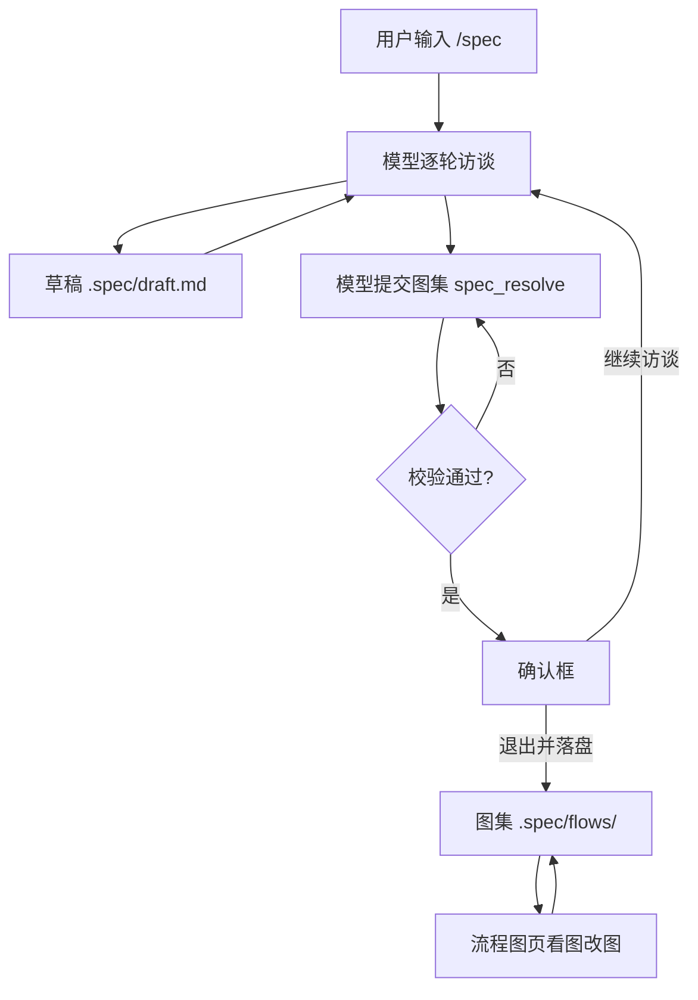

# 001 领域模型

这份文档命名这个项目的概念，以及每个概念守住的规则。代码（`chart-md.js`、`mermaid-graph.js`、`flows.js`、`state.js`）、工具（`spec_resolve`、`flow_read`、`flow_write`）、界面（流程图页）与其余文档用的都是这些词。取舍判据见 [000 原则](000-philosophy.md)。

## 流程

用户输入 `/spec` 说清这次要做什么；模型逐轮访谈，每轮把结论写进草稿；用户确认访谈结束后，模型提交一册图集；校验通过、用户在确认框里点「退出并落盘」，图集写进 `.spec/flows/`，草稿删除；此后人可以在流程图页里看图改图。



## 概念表

| 概念 | 定义 | 守住的规则 |
| --- | --- | --- |
| 项目锚点 | 会话工作目录向上找到的最近一个带 `.git` 的目录；找不到就是工作目录本身 | 所有产物路径都由它算出来 |
| spec 目录 | 锚点下的 `.spec/` | 唯一存放产物的位置 |
| 草稿 | `.spec/draft.md`，访谈期间唯一可写的文件 | 落盘时删除；有内容且模式关闭时，新会话会收到一条提醒 |
| 图集 | `.spec/flows/` 下全部 `<id>.md` | 有一张 id 为 `overview` 的图；模块框指得到、不成环 |
| 图 | 一册图集里的一份 Markdown 文件 | 四块齐全：`# 标题`、范围行、`mermaid` 块、`## 简报` |
| 源码 | 文件里 ` ```mermaid ` 块的内容 | 图的唯一表述；校验按行号报错 |
| 图集编号 | 图的 `id`，也是文件名 | 匹配 `[a-z][a-z0-9-]{0,23}`，全册唯一，落盘后不改 |
| 显示名 | 文件第一行 `# <name>` | 画在引用它的模块框上；作用变了就改它 |
| 作用范围 | 标题下面一行 | 非空，不超过 160 字符，不含「本次」「相关」这类无边界说法 |
| 种类 | 由 id 算出：`overview` 或 `module` | id 为 `overview` 的那张就是总览 |
| 节点 | 源码里一行 `n1["谁做了什么"]` | id 匹配 `[A-Za-z][A-Za-z0-9_-]{0,15}`，全图唯一 |
| 模块框 | 源码里一行 `n4[["<id><br/>入：…<br/>出：…"]]` | 第一行是图集里存在的 id；`<br/>` 后至少一条端口 |
| 端口 | 模块框上 `<br/>` 之后的每一行 | 写在父图上；每条不超过 60 字符 |
| 连线 | 源码里一行 `n1 --> n2` | 两端必须是已声明的节点；不自连；同一对节点只连一次 |
| 分叉条件 | 连线上 `-->|条件|` 里的字 | 出边两条以上时每条都要写；只有一条出边时不写；同一个框的两条出边不同条件 |
| 起点 | 没有前向入边的节点 | 一张图恰好一个 |
| 回箭头 | 指回已在栈上的节点的连线，即闭环的那条 | 可以有多条；不算第二个起点 |
| 排版 | 框与线的位置 | 由 mermaid 在浏览器里算出来，文件里不存 |
| 修订 | 整份 md 文本的 sha256 前 16 位 | 保存时比对，用来发现盘上已变 |
| 访谈 | 模型与用户之间多轮补齐需求的过程 | 每轮结论立刻进草稿；结束前做一次整体回述 |
| 落盘 | 把提交的图集写进 `.spec/flows/` 并退出模式 | 只写本次提交的图；被引用的图不能删；唯一的 overview 不能删 |
| 模式 | 这个会话是否处于 spec mode | 从会话日志折叠得出，恢复、分叉、重放都能还原 |
| 提醒 | 不阻止写入的附加消息 | 只有 `AGENTS.md` 有：行数预算、进度类内容 |

## 聚合

| 聚合根 | 持有什么 | 谁写 |
| --- | --- | --- |
| 图集 | 全部图的 `.md` 文件 | `spec_resolve`、`flow_write`、`/spec/flows/*` 路由 |
| 图 | 它的四块内容，一份文件承载 | 同上 |
| 草稿 | 访谈期间的结论 | 访谈中的模型写，落盘时插件删 |
| 模式 | 这个会话的 `active`、正在运行的命令、待确认的退出调用 | 投影从会话日志折叠 |

不是概念的东西：

| 东西 | 怎么接入 |
| --- | --- |
| 用户 | 通过 `/spec` 与 `/spec off` 命令、确认框、流程图页的输入框 |
| 模型 | 通过三个工具与 `spec:policy` 提示词段落 |
| 宿主的会话日志 | 投影读 `command/run`、`command/done`、`tool/call`、`tool/result` 四类事件 |
| 宿主的 web 服务 | 图集路由挂在 `/spec/flows` 前缀下，渲染库在 `/spec/flows/mermaid.js` |
| 浏览器里的 mermaid | 渲染源码块；库由宿主从本机 `node_modules` 读出来发过去 |

## 术语表

| 术语 | 中文 | 含义 |
| --- | --- | --- |
| spec mode | 访谈模式 | 工作树只读、只写草稿的那段会话状态 |
| chart | 图 | `.spec/flows/` 下的一份 Markdown 文件 |
| source | 源码 | 文件里 `mermaid` 块的内容，图的唯一表述 |
| overview | 总览 | id 为 `overview` 的那一张，全册唯一 |
| module | 模块图 | 被父图的模块框引用的图 |
| brief | 简报 | 文件末尾 `## 简报` 一节，四小节需求 |
| ports | 端口 | 模块框上写进出条件的行 |
| back edge | 回箭头 | 闭环的那条连线 |
| landing | 落盘 | 把提交的图集写进磁盘并退出模式 |
| projection | 投影 | 从会话日志折叠出的状态 |

## 枚举值

| 组 | 取值 |
| --- | --- |
| 图的种类 | `overview` 产品全貌，全册唯一 · `module` 被父图的模块框引用的图 |
| 源码的方向头 | `LR` 横向，也是所有工具写出来的那个 · `RL`、`TB`、`TD`、`BT` 也读 |
| 命令动作 | `on` 进入模式（裸 `/spec` 与 `/spec <想法>` 都算） · `off` 退出模式 |

节点的两种形状靠括号区分：`n1["…"]` 是步骤节点，`n4[["…"]]` 是模块框。

## 单张图的规则

| 规则 | 判据 |
| --- | --- |
| 编号 | 匹配 `[a-z][a-z0-9-]{0,23}`，小写字母开头 |
| 种类 | id 为 `overview` 是总览，其余是模块图 |
| 显示名 | 非空，不超过 40 字符 |
| 作用范围 | 非空，不超过 160 字符，不含「本次」「相关」「等等」「之类」「若干」「一些」 |
| 四块 | 有 `# 标题`、范围行、闭合的 ` ```mermaid ` 块；`## 简报` 可以空着 |
| 方向头 | 块的第一行是 `flowchart <方向>` |
| 节点 id | 匹配 `[A-Za-z][A-Za-z0-9_-]{0,15}`，全图唯一 |
| 节点数 | 至少两个 |
| 连线数 | 至少一条 |
| 连线两端 | 必须是已声明的节点；不自连；同一对节点只连一次 |
| 节点说明 | 一行，不超过 120 字符；两个框不同文；不含代码、理由词、本机绝对路径 |
| 端口 | 模块框至少一条，每条不超过 60 字符 |
| 起点 | 恰好一个 |
| 分叉条件 | 出边两条以上时每条都要写；只有一条出边时不写；同一框的两条出边不同条件 |
| 回路 | 允许，由 `backEdgesOf` 识别 |

## 图集的规则

| 规则 | 判据 | 强度 |
| --- | --- | --- |
| 总览在册 | 有一张 id 为 `overview` 的图 | 阻止 |
| 引用指得到 | 模块框第一行是图集里存在的 id | 阻止 |
| 引用不成环 | 模块图不再指回引用它的图 | 阻止 |
| 删除前先解引用 | 被引用的图、唯一的 overview 不能删 | 阻止 |
| 孤儿 | 没有图引用它 | 警告 |
| 顶层模块过多 | 一张图的模块框超过 6 个 | 警告 |
| 只写改动的图 | `charts` 里没有的图保持盘上原样 | 行为 |

## 简报的规则

简报是同一个文件末尾的一节，标题不重复：文件的 `# 标题` 就是它。

| 规则 | 判据 |
| --- | --- |
| 位置 | `## 简报` 之下，四小节各以 `###` 开头 |
| 四节 | `### 目标`、`### 要做什么`、`### 验收`；`### 约束` 可省 |
| 非空 | 目标一段；要做什么与验收各至少一条 |
| 一行一条 | 单行不超过 400 字符，字段内不换行，不以 `#` 开头 |
| 无代码 | 围栏块与反引号里的调用、赋值、块、比较都拒；以程序名开头的纯命令放行 |
| 无理由 | 含「为什么 / 为何 / 因为 / 之所以 / 权衡 / 取舍 / 背景 / 动机 / 被否决 / 备选方案 / 替代方案 / 方案比较 / 好处是 / 理由是 / 考虑到 / 出于」及对应英文词 |
| 无本机路径 | `/home/`、`/Users/`、`/storage/`、`/nix/store/`、`C:\` 一律拒 |

简报由模型写时跑这套校验；人在页面上改同一份文件不受约束。
