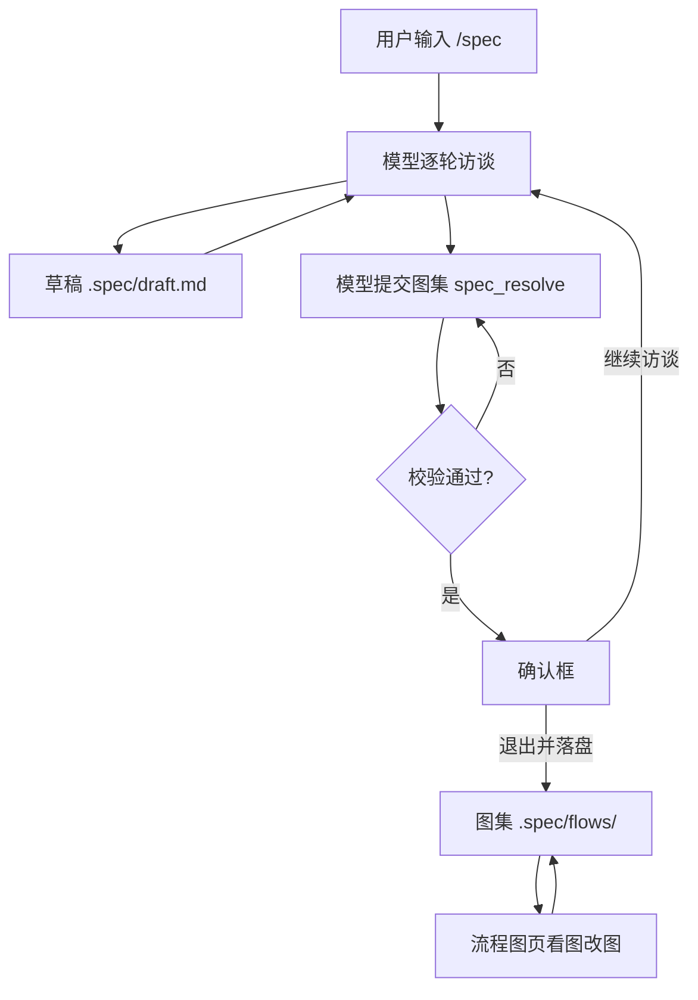

# 001 领域模型

这份文档命名这个项目的概念，以及每个概念守住的规则。代码（`flow.js`、`flows.js`、`state.js`）、工具（`spec_resolve`、`flow_read`、`flow_write`）、界面（流程图页）与其余文档用的都是这些词。取舍判据见 [000 原则](000-philosophy.md)。

## 流程

用户输入 `/spec` 说清这次要做什么；模型逐轮访谈，每轮把结论写进草稿；用户确认访谈结束后，模型提交一册图集；校验通过、用户在确认框里点「退出并落盘」，图集写进 `.spec/flows/`，草稿删除；此后人可以在流程图页里看图改图。

## 概念表

| 概念 | 定义 | 守住的规则 |
| --- | --- | --- |
| 项目锚点 | 会话工作目录向上找到的最近一个带 `.git` 的目录；找不到就是工作目录本身 | 所有产物路径都由它算出来 |
| spec 目录 | 锚点下的 `.spec/` | 唯一存放产物的位置 |
| 草稿 | `.spec/draft.md`，访谈期间唯一可写的文件 | 落盘时删除；有内容且模式关闭时，新会话会收到一条提醒 |
| 图集 | `.spec/flows/` 下的全部图 | 恰好一张总览；模块引用指得到、不成环 |
| 图 | 一册图集里的一张，由三个同主名文件组成 | `id` 是文件名，一经落盘不再改名 |
| 图的模型 | `<id>.json`：`id`、`kind`、`name`、`scope`、`nodes`、`edges` | 是唯一的事实来源；图片从它画出来 |
| 图片 | `<id>.png`，本机没有转换器时是 `<id>.svg` | 模型变了就重画；重画失败的图不影响模型有效 |
| 简报 | `<id>.brief.md`，这张图自己的四节需求 | 可选；内容为空时文件不存在 |
| 图集编号 | 图的 `id`，也是文件名 | 匹配 `[a-z][a-z0-9-]{0,23}`，全册唯一，落盘后不改 |
| 显示名 | 图的 `name` | 画在引用它的模块框上；作用变了就改它 |
| 作用范围 | 图的 `scope`，一行写死从哪一步到哪一步 | 含「本次」「相关」这类无边界说法会被拒 |
| 节点 | 图里的一个框 | `id` 匹配 `[A-Za-z][A-Za-z0-9_-]{0,15}`，全图唯一 |
| 步骤节点 | `{ id, label }`，一个框写「谁做什么」 | `label` 一行、不超过 120 字符、不写代码、不写理由、不写本机路径 |
| 模块节点 | `{ id, module, ports }`，一个框代表另一张图 | 不写 `label`；`ports` 至少一条；`module` 必须是图集里存在的 id |
| 端口 | 模块节点上的 `ports`，写这个模块接进来与出去的条件 | 写在父图上，不写在子图里；每条不超过 60 字符 |
| 连线 | 图里的一条箭头 `{ from, to, when? }` | 两端必须是已声明的节点；不自连；同一对节点只连一次 |
| 分叉条件 | 连线上的 `when` | 一个框有两条以上出边时每条都要写；只有一条出边时不写；同一个框的两条出边不能同条件 |
| 起点 | 没有前向入边的节点 | 一张图恰好一个 |
| 回箭头 | 指回已在栈上的节点的连线，即闭环的那条 | 可以有多条；层次与排版跳过它们 |
| 层 | 节点在去掉回箭头后的最长路径深度 | 由模型算出，不存 |
| 行 | 一层放不下时折行得到的一行框 | 由模型算出，不存 |
| 修订 | 模型规范文本的 sha256 前 16 位 | 保存时比对，用来发现盘上已变 |
| 访谈 | 模型与用户之间多轮补齐需求的过程 | 每轮结论立刻进草稿；结束前做一次整体回述 |
| 落盘 | 把提交的图集写进 `.spec/flows/` 并退出模式 | 只写本次提交的图；被引用的图不能删；唯一的 overview 不能删 |
| 模式 | 这个会话是否处于 spec mode | 从会话日志折叠得出，恢复、分叉、重放都能还原 |
| 提醒 | 不阻止写入的附加消息 | 只有 `AGENTS.md` 有：行数预算、进度类内容 |

## 聚合

| 聚合根 | 持有什么 | 谁写 |
| --- | --- | --- |
| 图集 | 全部图的模型、图、简报 | `spec_resolve`、`flow_write`、`/spec/flows/*` 路由 |
| 图 | 它的模型、它的图、它的简报 | 同上；三个文件共享一个 `id` |
| 草稿 | 访谈期间的结论 | 访谈中的模型写，落盘时插件删 |
| 模式 | 这个会话的 `active`、正在运行的命令、待确认的退出调用 | 投影从会话日志折叠 |

不是概念的东西：

| 东西 | 怎么接入 |
| --- | --- |
| 用户 | 通过 `/spec` 与 `/spec off` 命令、确认框、界面表单 |
| 模型 | 通过三个工具与 `spec:policy` 提示词段落 |
| 宿主的会话日志 | 投影读 `command/run`、`command/done`、`tool/call`、`tool/result` 四类事件 |
| 宿主的 web 服务 | 图集路由挂在 `/spec/flows` 前缀下 |
| 本机转换器 | `rasterize.js` 探测，不属于模型 |

## 术语表

| 术语 | 中文 | 含义 |
| --- | --- | --- |
| spec mode | 访谈模式 | 工作树只读、只写草稿的那段会话状态 |
| chart | 图 | 一册图集里的一张，三个同主名文件 |
| overview | 总览 | `kind` 为 `overview` 的那一张，全册唯一 |
| module | 模块图 | `kind` 为 `module` 的图，被父图引用 |
| ports | 端口 | 模块节点上写进出条件的字符串数组 |
| back edge | 回箭头 | 闭环的那条连线 |
| landing | 落盘 | 把提交的图集写进磁盘并退出模式 |
| projection | 投影 | 从会话日志折叠出的状态 |

## 枚举值

| 组 | 取值 |
| --- | --- |
| 图的 `kind` | `overview` 产品全貌，全册唯一 · `module` 被别的图引用的模块图 |
| 命令动作 | `on` 进入模式（裸 `/spec` 与 `/spec <想法>` 都算） · `off` 退出模式 |

节点有两种形状，靠有没有 `module` 字段区分：有 `module` 是模块节点，没有是步骤节点。两种不会同时出现。

## 单张图的规则

| 规则 | 判据 |
| --- | --- |
| 编号 | 匹配 `[a-z][a-z0-9-]{0,23}`，小写字母开头 |
| 类型 | `overview` 或 `module` |
| 显示名 | 非空，不超过 40 字符 |
| 作用范围 | 非空，不超过 160 字符，不含「本次」「相关」「等等」「之类」「若干」「一些」 |
| 节点 id | 匹配 `[A-Za-z][A-Za-z0-9_-]{0,15}`，全图唯一 |
| 节点数 | 至少两个 |
| 连线数 | 至少一条 |
| 连线两端 | 必须是已声明的节点；不自连；同一对节点只连一次 |
| 节点说明 | 一行，不超过 120 字符；两个框不同文；不含代码、理由词、本机绝对路径 |
| 端口 | 模块节点至少一条，每条不超过 60 字符 |
| 起点 | 恰好一个 |
| 分叉条件 | 出边两条以上时每条都要写；只有一条出边时不写；同一框的两条出边不同条件 |
| 回路 | 允许，由 `backEdgesOf` 识别；层次与排版跳过回箭头 |

## 图集的规则

| 规则 | 判据 | 强度 |
| --- | --- | --- |
| 总览唯一 | 全册 `kind` 为 `overview` 的恰好一张 | 阻止 |
| 引用指得到 | 模块节点的 `module` 是图集里存在的 id | 阻止 |
| 引用不成环 | 模块图不再指回引用它的图 | 阻止 |
| 删除前先解引用 | 被引用的图、唯一的 overview 不能删 | 阻止 |
| 孤儿 | 没有图引用它 | 警告 |
| 顶层模块过多 | 一张图的模块框超过 6 个 | 警告 |
| 只写改动的图 | `charts` 里没有的图保持盘上原样 | 行为 |

## 简报的规则

| 规则 | 判据 |
| --- | --- |
| 四节 | `# 标题`、`## 目标`、`## 要做什么`、`## 验收`；`## 约束` 可省 |
| 非空 | 标题与目标一行；要做什么与验收各至少一条 |
| 一行一条 | 单行不超过 400 字符，字段内不换行，不以 `#` 开头 |
| 无代码 | 围栏块与反引号里的调用、赋值、块、比较都拒；以程序名开头的纯命令放行 |
| 无理由 | 含「为什么 / 为何 / 因为 / 之所以 / 权衡 / 取舍 / 背景 / 动机 / 被否决 / 备选方案 / 替代方案 / 方案比较 / 好处是 / 理由是 / 考虑到 / 出于」及对应英文词 |
| 无本机路径 | `/home/`、`/Users/`、`/storage/`、`/nix/store/`、`C:\` 一律拒 |

简报由模型写时跑这套校验；人在页面上改同一个文件不受约束。
