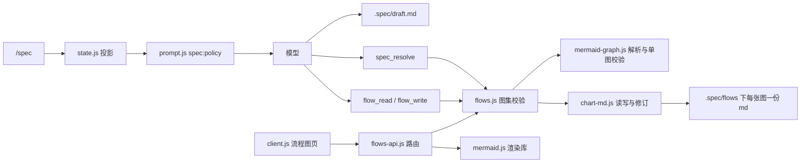
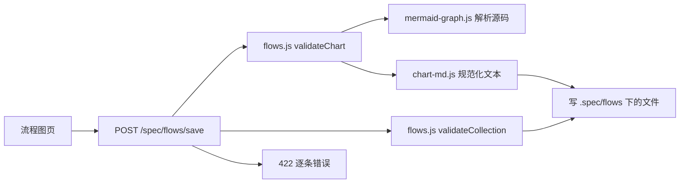

# 007 架构

这份文档把 [001 领域模型](001-domain.md) 的概念映射到文件与函数，并给两张索引表：模块表与测试表。先读「核心对象」与「依赖规则」，两张表当索引用。它建立在 [000 原则](000-philosophy.md) 到 [006 部署](006-deployment.md) 之上。

## 核心对象

模型的层次是：一份草稿喂出一册图集，图集是一组 `.spec/flows/<id>.md`；每份文件自带标题、范围、mermaid 源码与简报；每条入口都收在同一个校验器上，渲染在浏览器里发生。

## 一次保存经过哪些模块

## 核心类

### 投影 `state.js`

拥有的：投影键 `spec`、状态版本 `1`、状态三个字段 `active` / `running` / `exitCall`、所有产物路径的解析函数、创建 `.spec/` 目录、判断草稿是否有内容。

依赖：`node:fs`、`node:path`。

### 源码 `mermaid-graph.js`

拥有的：`mermaid` 块的解析与单图规则——方向头、节点行、模块框与端口、连线与分叉条件、节点 id 与说明、起点、回箭头识别；把图写回源码。导出 `parseMermaid()`、`validateGraph()`、`drawMermaid()`、`drawMermaidNamed()`、`backEdgesOf()`。

输入：一段源码，不知道图集里有几张图；输出：`{ direction, nodes, edges }` 或带行号的错误。模块框要能对上图集，需要调用方传 `knownModules`。

依赖：无。

### 文件 `chart-md.js`

拥有的：一份 `.md` 的四块与规范化文本、`revisionOf()`、`chartPath()`、`graphOf()`；写出来的文本固定，两个写者内容相同就字节相同。

输入：`{ id, name, scope, source, brief }`；输出：文件文本或读回的图。

依赖：`mermaid-graph.js`、`node:crypto`、`node:path`。

### 图集 `flows.js`

拥有的：图集的规则——有一张 `overview`、引用指得到、引用不成环、孤儿与模块过多的警告、删除保护；还有全部磁盘读写与修订号；`kindOf()` 从 id 算出种类；`drawableChart()` 把模块框换成被引用图的标题。导出 `validateChart()`、`validateCollection()`、`readCollection()`、`writeChart()` 等。

输入：已经解出图的单张文件内容；输出：校验后的图与磁盘读写。

依赖：`chart-md.js`、`mermaid-graph.js`、`node:fs`、`node:path`。

### 路由 `flows-api.js`

拥有的：`/spec/flows/{list,chart,save,create,delete}` 五个 JSON 接口、`/spec/flows/mermaid.js` 这条库路由、请求体上限、403 与 404 的拒绝、修订号冲突的 409。

输入：HTTP 请求；输出：JSON 响应，图合不合格由 `flows.js` 判定。

依赖：`flows.js`、`mermaid-graph.js`、`node:fs`、`node:module`、`node:os`、`node:path`。

### 守卫 `guard.js`

拥有的：路径分类 `draft` / `working-tree` / `protocol`，工具名谓词。

输入：一次工具调用的名字与参数；输出：`protocol` / `draft` / `working-tree` 三种分类。

依赖：`node:path`。

## 依赖规则

谁可以 import 谁：

| 模块 | 可以 import |
| --- | --- |
| `state.js`、`guard.js`、`prompt.js`、`advisories.js`、`brief.js` | 只有 `node:` 标准库 |
| `mermaid-graph.js` | 无 |
| `chart-md.js` | `mermaid-graph.js` + 标准库 |
| `flows.js` | `chart-md.js`、`mermaid-graph.js` + 标准库 |
| `flows-api.js` | `flows.js`、`mermaid-graph.js` + 标准库 |
| `index.js` | 上面全部 |
| `client.js` | 只经 HTTP 与宿主注入，不 import 服务端模块 |

状态只有一个写者：

| 状态 | 写者 |
| --- | --- |
| 草稿 | 访谈中的模型 |
| 图的 `.md` | `spec_resolve`、`flow_write`、`/spec/flows/save`、`/spec/flows/create` |
| 图集目录与删除 | `spec_resolve`、`/spec/flows/delete` |
| 简报 | 存在图的 `.md` 里，随那份文件一起写 |
| 模式 | `state.js` 的折叠，唯一 |
| `AGENTS.md` | 模型，插件只提醒 |

## 模块

| 路径 | 职责 |
| --- | --- |
| `index.js` | 插件入口：注册投影、提示词段落、`/spec` 命令、三个工具、守卫、图集路由，并决定落盘顺序 |
| `state.js` | 折叠会话日志得出模式状态，解析产物路径 |
| `guard.js` | 把工具目标路径分类成草稿、工作树或协议路径 |
| `prompt.js` | 提供 `spec:policy` 提示词与跨会话草稿提醒的文字 |
| `advisories.js` | 对 `AGENTS.md` 的写入做行数与进度两条不阻止写入的提醒 |
| `brief.js` | 校验与渲染简报的四个小节，并把写好的简报读回结构 |
| `chart-md.js` | 读写一份图的 Markdown：四块、规范化文本、修订号 |
| `mermaid-graph.js` | 解析 `mermaid` 源码，校验单张图的节点、模块框、连线、分叉条件与起点，把图写回源码 |
| `flows.js` | 校验整册图集：有 overview、引用指得到、不成环；读写文件，算修订号，识别种类 |
| `flows-api.js` | 提供 `/spec/flows` 下五个 JSON 接口与 mermaid 库路由给流程图页用 |
| `client.js` | 流程图页：列图集、渲染或编辑源码、改简报、保存、新建、删除 |
| `doc-flow.mjs` | 生成这个仓库自己的图集：`npm run flow`，只写 `.md` |
| `selftest.mjs` | 纯逻辑断言：不启宿主也能跑的 54 项 |
| `landing-test.mjs` | 用假上下文驱动真实 `apply()` 的 15 项接线断言 |

## 测试

| 测试 | 覆盖什么 |
| --- | --- |
| `selftest.mjs` | 锚点与路径、守卫分类、投影折叠、简报校验、源码解析与单图校验、模块框与端口、图集规则、回箭头识别、读写往返、修订号、`AGENTS.md` 提醒 |
| `landing-test.mjs` | `apply()` 的注册、路由挂载、提示词段落、确认框的三条分支、落盘写盘、守卫拦截、`AGENTS.md` 提醒接线 |

## 持久化

| 文件 | 存什么 | 谁写 |
| --- | --- | --- |
| `.spec/draft.md` | 访谈期间的结论 | 模型 |
| `.spec/flows/<id>.md` | 一张图的四块：`# 标题`、范围行、`mermaid` 块、`## 简报` | 落盘、`flow_write`、页面保存 |
| `AGENTS.md` | 文档索引与开发规范规则 | 模型 |

投影状态由宿主持久化，插件自己不写：键 `spec`，版本 `1`。

## 对外接口

工具：

| 工具 | 参数 | 返回 |
| --- | --- | --- |
| `spec_resolve` | `charts[]` 每项含 `id`、`name`、`scope`、`source` 与可选 `brief`；可选 `removed[]` | `exited`、`charts[]`（每项含 `id`、`path`、`brief`）、`removed`、`warnings` |
| `flow_read` | 可选 `id` | `charts[]`、`problems[]`；带 `id` 时另有 `chart`、`revision`、`brief` |
| `flow_write` | `chart`、可选 `revision` | `id`、`revision`、`path`、`warnings` |

路由：

| 方法 | 路径 | 返回 |
| --- | --- | --- |
| GET | `/spec/flows/mermaid.js` | 本机 mermaid 库的脚本体 |
| GET | `/spec/flows/list` | `specDir`、`problems`、`charts[]` |
| GET | `/spec/flows/chart` | `chart`、`source`、`drawn`、`revision` |
| POST | `/spec/flows/save` | `id`、`revision`、`path`、`warnings` |
| POST | `/spec/flows/create` | `id`、`revision` |
| POST | `/spec/flows/delete` | `removed` |

响应码：200 成功，403 `forbidden`，404 `no-session` / `no-chart` / `no-route`，409 `conflict` / `exists`，422 `invalid`，500 `failed`。

`chart` 的 `source` 是文件里的原文，`drawn` 是同一张图但模块框已换成被引用图的标题——页面渲染用后者，保存写回前者。

## 配置热更新

| 改动 | 生效方式 |
| --- | --- |
| 提示词、工具描述、命令描述 | 下一个请求，不需要重启 |
| 界面文案 | 重新加载页面 |
| 校验规则、产物路径 | 需要重启宿主 |
| mermaid 库的位置 | 重启宿主；`DSH_SPEC_MERMAID` 在解析路径时读 |
| `AGENTS.md` 行数预算 | 下一次写入 |
